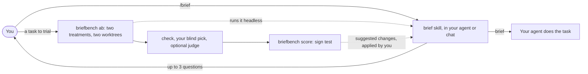

# briefbench design

Status: the redesign, approved 2026-11-02 and revised after review on 2026-11-03, replaced the first plan. The revision keeps the skill to prompt enhancement alone, and runs the bench on your subscriptions instead of API keys; "Decisions" lists what changed. Stage 0 (trim and redocument) is done; stages 1–3 are next, on the branch `redesign`. See "Stages". The first plan's stage 1, `briefbench rewrite` (PR #1), is retired apart from its log.

**Why this project exists.** It started with one question about Felix Rieseberg's essay ["How to be more ambitious: A tutorial for humans with models"](https://felixrieseberg.com/how-to-be-more-ambitious-a-tutorial-for-humans-with-models/) (13 Oct 2026): is its advice really useful? briefbench makes that a habit. Apply a post's advice as a prompt treatment, and measure it on your own tasks before trusting it.

## Decisions at a glance

| Question | Decision |
|---|---|
| What briefbench is | Two separate parts: a prompt improver you use every day, and a small bench that checks whether it helps |
| First question | Is the ambition essay's advice useful on your tasks? Answered once the bench works; see "First experiment" |
| Front end | `brief`, an Agent Skill: one `SKILL.md`, no code. It only improves prompts: it logs nothing and keeps no records |
| Back end | `briefbench`, a small CLI that runs blind paired trials on your own tasks |
| Interface | None at run time. The bench runs the skill's folder headless, as a black box, and keeps every record itself |
| Cost | Your subscriptions only. Every model call goes through an agent CLI logged in with your Claude or ChatGPT plan, such as Claude Code or Codex. No API keys and no per-token charges |
| Measurement | Two treatments of the same task, same worker, one run each. By default the two are your original prompt and the brief. A check decides first, then your blind pick; an optional judge from a third vendor rules alongside. A two-step sign test with its rule fixed in advance |
| What can be tested | Any prompt treatment: the brief, another skill version, or a tip someone claims works (such as "make the AI ambitious") added as a snippet |
| Reuse | Skill ideas from ECC prompt-optimizer and claude-code-prompt-improver (MIT). Judge prompt from Arena-Hard-Auto (Apache-2.0). Claude Code and Codex as the model runners. The first plan's log |
| Size | Skill at most 150 lines. Bench about 1,000 lines: about 150 kept from the first plan, about 850 new |

## How it fits together



The skill works without the bench and knows nothing about it. The bench never parses the skill: it hashes the skill's folder to tell versions apart, and hands its text to an agent CLI to write headless briefs. To test a change, it compares two treatments: two skill versions, or a skill and a claimed tip.

## Constraints

- **Two separate parts.** The front end is built only for the best brief, never for ease of measurement. It logs nothing and keeps no records. The back end tests it as a black box.
- **Cheap.** The bench costs nothing beyond the subscriptions you already have. It calls models only through agent CLIs logged in with those plans, never through a paid API.
- **Any model, any harness.** It must work with Claude, ChatGPT, Gemini, DeepSeek, local models, and agent CLIs such as Claude Code, Codex and Gemini CLI. Nothing in the core may depend on one vendor.
- **Small first.** Build in stages. Each stage must be useful on its own before the next one starts.
- **Every tip is a hypothesis.** No technique becomes a default just because someone recommends it, including the sources below. It has to win on your own tasks.

## Front end: the `brief` skill

**Why a skill.** A skill is the widest-reaching packaged form, and its body still works as a pasted prompt anywhere else.
- **An open standard.** Anthropic published Agent Skills in December 2025 and gave the standard to the Linux Foundation's Agentic AI Foundation on 22 Oct 2026.
- **Native support:**
  - Claude Code, the Claude apps, the Claude API
  - Codex, and ChatGPT on business plans
  - Gemini CLI, Antigravity, Cursor, GitHub Copilot, Devin Desktop and Zed
- **The host's own model and context.** It uses the host's model, files, repo, conversation and question tool, with no API key.
- **Alternatives:**
  - An MCP server needs a running process and per-client setup, and support for its prompts is patchy.
  - A CLI sits outside the chat and sees none of your context.

**What you do.**
1. Write your prompt, then type `/brief`; it uses your last message. Or type `/brief <prompt>`. Each host invokes it differently:
   - Codex: `$brief`
   - ChatGPT: `@brief`
   - The Claude apps and Gemini CLI pick skills on their own, so there you ask for "a brief".
2. It reads what the prompt points to (files, links, earlier messages) and nothing more.
3. In one message it asks at most three questions, and only those the prompt and context leave open:
   - Why do you want this?
   - How will the result be checked by something other than the model?
   - What would a stretch result look like? (optional)

   It uses the host's question tool when there is one. You can skip any question, and it asks nothing when you say so or the run is headless.
4. It returns **one rewritten brief** in a copyable block, and offers to run it.

**Rules for the brief.**
- Keep the requester's specifics word for word: names, numbers, paths, commands, quoted text.
- Add nothing they didn't say or point to. Leave a skipped answer out; don't guess it.
- No personas, praise, threats, capitals for emphasis, or advice that fits any task.
- Write in the prompt's language. Keep only the parts that have content.

**Techniques**, inside `SKILL.md`. The skill starts with the five techniques the first plan set for its stage 1. It holds only the techniques it applies: no status markers and no retired list, because the bench keeps those records. Changing them later is just a new skill version for the bench to compare.
1. **Background and why:** what the result is for and what happens next with it.
2. **Outcome, with a stretch target:** the required end state. A stretch target appears only if you gave one, labelled as an aim with a request to report how close the work came.
3. **Verification outside the model:** your checks, exactly as given, with a request to run them and report the actual results. Never "double-check your work".
4. **Definition of done:** what must be true and what to hand back, only from what you said or directly implied.
5. **Constraints and non-goals:** limits in your words, with non-goals marked.

**Files and install.** The source lives in `skills/brief/`; installed copies are not edited.

| Host | Install |
|---|---|
| Claude Code | Copy the folder to `~/.claude/skills/brief/` |
| Codex, Cursor, Copilot, Gemini CLI, Antigravity, Devin Desktop | Copy to `.agents/skills/brief/` in a project, or use `npx skills add Freedom-Jack/briefbench` |
| Claude apps, ChatGPT | Upload a ZIP |
| Anything else | Paste `SKILL.md`, or keep it in a Project, GPT or Gem |

`agents/openai.yaml` tells Codex to run the skill only when called. The frontmatter uses only the standard fields; `metadata.version` names the version for people, while the bench tells versions apart by their content.

## Back end: `briefbench`

**What it measures.** Take a real task you hand off whole. Which of two *treatments* gives a result that better meets your goal? A treatment turns your prompt, plus your answers to the skill's questions, into the prompt the worker receives. By default the two are your original prompt and the brief.

Both arms use the same worker (agent CLI, model and settings), start from the same commit and run once each. Tasks differ more than prompts do, so comparing two treatments on the same task is the efficient way to measure. Extra time, and tokens where the worker reports them, are recorded.

| Treatment | What the worker receives |
|---|---|
| `original` | Your prompt as written |
| `brief` | A brief written headless by your installed `brief` skill, from your prompt and your answers to `ab`'s questions |
| `skill:<folder>` | The same, written by the skill in that folder |
| `snippet:<file>` | Your prompt plus a fixed text, such as a claimed trick |

A headless brief is written by the rewriter: an agent CLI with a frozen model. It gets the skill's `SKILL.md` as instructions, asks nothing, and can read the repo but not change it. Removing one technique is just another treatment: a copy of the skill folder without it.

**It runs on your subscriptions.** Every model call goes through an agent CLI logged in with your own plan, so a trial adds no per-token charge:
- **Worker:** Claude Code (`claude -p`) on your Claude plan, or Codex (`codex exec`) on your ChatGPT plan. The ChatGPT desktop app includes the Codex CLI, already logged in. Claude Code needs `claude auth login` once in a terminal.
- **Rewriter:** the same kind of CLI, reading only.
- **Judge:** a CLI from a third vendor, reading only, with its reply held to a JSON schema. With Claude Code as worker and rewriter, that is Codex.
- **Allowed.** Both vendors document these commands for scripts run with your own login. What their terms bar is sharing that login with other people or services; the bench runs only on your machine, for you.
- **No API billing.** Claude Code bills `ANTHROPIC_API_KEY` instead of your plan whenever it is set, so each CLI starts without API key variables in its environment.
- **No overflow billing.** Plans have 5-hour and weekly usage limits, shared with their apps. Keep pay-as-you-go extra usage off in your account, so a trial that reaches a limit stops instead of billing you.

**Protocol.**
1. **Freeze.** `briefbench init` records:
   - both treatments. For a skill, that is a hash of its folder. For a snippet, it is a hash of its text
   - the rewriter: the CLI and model that write headless briefs
   - the worker command and model
   - the judge (or none) and your cost cap
   - the decision rule

   Any other change starts a new experiment. `ab` refuses to run when a skill folder or a snippet has changed since `init`.
2. **Pick tasks before any brief exists.** `ab` takes your prompt, not a brief, so a brief can't sway which tasks you trial. Only self-contained tasks count:
   - nothing that leans on earlier chat, because neither arm would see it
   - no side effects outside the repo
   - nothing you'll steer midway

   `ab` asks these three questions. A "yes" logs an exclusion and stops. `score` reports exclusions.

   `ab` also asks the task type, from a short list (code, writing, research, analysis, other). Later stages can then split results by type, and that data can't be added afterwards.
3. **Run.** `briefbench ab "<prompt>"`:
   - It asks the skill's three questions: why you want this, how the result will be checked, and an optional stretch result. Your answers give the goal and the check command, and the headless skill gets them too.
   - It renders each treatment's prompt.
   - It makes two git worktrees of the current commit.
   - It runs the repo's setup command in each, since worktrees lack ignored files such as `.venv` and `node_modules`.
   - It starts both arms together, with a timeout.
   - It runs your check in each worktree, after putting the protected paths (your test files) back from the commit. An agent that changed them fails the check.
4. **Decide.**
   - If exactly one arm passes the check, the check decides.
   - Otherwise you pick A, B or tie, blind. Sides are random, and you see only the diffs and briefbench's check output. You never see the agents' own summaries, the prompts or the stretch target. You can also guess which side was which treatment, to test the blinding.
   - If the judge is on, it rules in both orders on the same material plus your goal, and a verdict that flips counts as a tie. Its verdicts are only recorded until it agrees with at least 80% of your picks over 20 or more pairs.
   - You keep the winner: `ab` prints the command that applies its diff.
5. **Noise check.** Before the experiment, run `ab --aa` on 5 tasks: treatment A against itself (by default, the original). If you or the judge often see a winner there, noise is high, and the experiment will need more pairs. Running each arm 3 times instead would triple the cost.
6. **Decision rule**, fixed in advance. It uses an exact two-sided sign test on pairs with a winner; ties are reported but not counted. B is the newcomer: by default, the brief.
   - At 20 decided pairs: adopt B at 16 or more wins, and stop at 10 or fewer.
   - Otherwise continue to 40 decided pairs, and adopt at 27 or more.
   - Adopt only if the median extra cost is under your cap.
   - If fewer than 20 of 40 trials are decided, report "no practical difference".

   Checked by exact calculation:
   - It wrongly adopts a useless rewrite 2.2% of the time (the first plan's 21-of-30 rule: 2.1%).
   - It catches a true 75% win rate 90% of the time (21 of 30: 80%), and a true 65% rate 45% of the time.
   - With no real effect, it usually stops at 20 pairs (59%).

   Not adopting means no large effect was found, not that there is no effect.

**How many pairs a smaller effect needs.** Decided pairs for a single sign test at the 5% level to catch a real effect 4 times in 5:

| True win rate | Decided pairs needed |
|---|---|
| 80% | about 20–25 |
| 75% | about 30–35 |
| 70% | about 50–55 |
| 65% | about 90–100 |
| 60% | about 200 |

So test the whole brief against the original first, and test single techniques only after the whole brief wins.

**`briefbench score`** prints:
- wins, losses and ties, the p-value, the 95% interval and the verdict
- median extra time and tokens
- how often the judge agreed with you, and how often the longer output won
- exclusions

It never reports a single pair as evidence.

**Effort and cost.**
- About a minute to answer `ab`'s questions, and 2–5 minutes to pick. You keep the better result.
- 25–50 tasks over a few weeks is about 1–4 hours in total.
- No money beyond your subscriptions. Each trial uses one extra agent run, one short headless rewrite and, when the judge is on, two short judge calls. They count against your plans' usage limits, not a bill.

**Testing a technique someone claims works.** Take a post claiming that opening with "You are a world-class expert" improves results. Outside studies found that personas give no consistent gain, so this also checks that the bench doesn't report false wins.
1. Write the claim down as a treatment:
   - as `snippet:persona.md`, to test it alone against `original`
   - or as a skill variant with it added as a new technique, to test it against the current skill
2. Run `briefbench init persona --a skill:skills/brief --b skill:variants/brief-persona`, then `ab` on real tasks as they come.
3. `score` gives the verdict. A winner joins the skill's techniques, on trial in the bench's records; a loser is recorded and dropped.

Claims like this usually have smaller effects than the whole brief. A 65% win rate needs about 90 decided pairs. So these tests run only after the brief itself is adopted, each with a run budget. They lean on the judge once it is trusted, and on replaying logged tasks. Replaying is fair for a claim from outside, which your logged tasks didn't shape. A technique you edit after seeing trial results is tested only on tasks collected after the edit.

**What comes back** is a suggested status for each technique and worker model, never an automatic edit:
- *kept* if removing the technique loses significantly
- *retired* if removing it wins, or if it costs a question and shows no difference after 40 decided pairs
- otherwise *on trial*

The bench keeps these statuses in its records, never in the skill. You edit the skill source, for example to remove a retired technique, then bump its version and reinstall. Records for a worker model are marked stale when that model changes.

**Privacy.**
- Everything stays under `~/.briefbench/`. The bench handles no API keys: each agent CLI uses your own login.
- The judge sends diffs and check output to a third vendor, under your plan's data terms, so it is off unless you allow it for a repo.

## First experiment: is the essay's advice useful?

The essay names four kinds of ambition. It sets speed aside and works through three:
- **Altitude:** aim at the outcome behind the task.
- **Depth:** work the way a field's best professionals do, starting from raw material.
- **Range:** borrow from other fields.

Its evidence is the author's own experience, with no measurements. Today's skill carries only part of it:

| The essay's advice | In the skill today |
|---|---|
| Decide what you want to happen next, and state the purpose | Yes: the "why" question and background-and-why |
| Ask for the outcome, not the task | Partly: the outcome is stated, but the brief keeps your task |
| Set targets far past the real need | Yes, when you answer the stretch question; none is invented |
| Insist when the model says a target is impossible | No; left out as an untested extra |
| **Depth:** before rewriting, state what a top professional would do that wasn't asked, the rawest material, their methods and tools, and what outside check would show the result is right | No. This is the essay's most distinctive rewrite technique, and nobody has measured it |
| **Range:** borrow from other fields, with specialist and red-team views | No |
| Verify by something other than the model | Yes: external-verification, the essay's strongest point |
| Ask for an expert's methods, not their voice | Yes: the no-persona rule |
| Definition of done; constraints and non-goals | Not from the essay. These are briefbench's own candidates |

So `original` vs `brief` tests three of the essay's ideas mixed with two of briefbench's own. On its own, it can't say whether the essay is useful.

**When to decide: after stage 3.** Nothing in the build depends on it. Each question below is only a choice of which two treatments `briefbench init` compares, and an essay version of the skill is one more folder, written when you get there. The skill is built with the first plan's five techniques.

There are two questions. Ask them in either order, each with its own 20–40 decided pairs:
1. **Does the essay's method help?** Write `variants/essay/`, the skill with techniques taken from the essay alone:
   - the purpose
   - the outcome over the task
   - the stretch target, with the push to keep going
   - depth
   - range
   - outside verification

   Then run `original` vs `skill:variants/essay`.
2. **Does your daily brief help?** Run `original` vs `brief`.

After that, single parts of the essay, such as depth or insisting, can be tested as variants, each with its own budget. The essay notes that ambition suits outcome-driven work better than creative work, which is why the task type is logged from the first trial.

## Architecture

**Repo layout.**

```text
skills/brief/
  SKILL.md                  steps, rules, techniques; at most 150 lines
  agents/openai.yaml        Codex: run only when called
src/briefbench/
  errors.py redact.py log.py
                            kept: errors, key scrubbing, the append-only log
  presets.py                rewritten: how to run Claude Code and Codex as worker, rewriter and judge
  treatments.py             new: render original, skill:<folder> and snippet:<file> prompts, with the headless rewrite
  experiment.py             new: init, freeze, treatment hashes, repo settings
  runner.py                 new: worktrees, setup, both arms, protected paths, checks
  judge.py, judge_prompt.md new: pairwise judge, both orders
  stats.py                  new: sign test, interval, decision rule
  score.py                  new: the report
  cli.py                    rewritten: init, ab, score, clean
tests/                      kept tests for kept modules; new tests use fake agent CLI scripts
```

**Data, all under `~/.briefbench/`.** Set `BRIEFBENCH_HOME` to move it.

```text
experiments/<name>.json       frozen settings, one per experiment
repos.json                    per repo: setup command, check command, protected paths, judge allowed
log.jsonl                     append-only, mode 0600: trial, aa and excluded lines
trials/<id>/a, b, output/     worktrees and captured output; `clean` removes the worktrees
```

**Commands.**

| Command | What it does |
|---|---|
| `briefbench init <name> [--a <treatment>] [--b <treatment>] [--judge <cli>]` | Asks for the worker, the rewriter and your cost cap, shows the commands it will run, then freezes the experiment. Defaults: `--a original --b brief`, no judge |
| `briefbench ab "<prompt>" [--aa]` | The prompt as an argument, or `-` to paste it. Eligibility questions and task type; the skill's three questions, which give the goal and the check; the headless brief; both arms; check; blind pick; judge; one log line with both treatments; prints how to keep the winner |
| `briefbench score [<name>]` | The report above |
| `briefbench clean` | Removes finished trial worktrees |

**Runner.**
- Each agent CLI's templates for its three roles live in `presets.py`, as argv lists with a `{prompt}` slot. There is no shell, so prompts need no quoting.
- Every CLI starts with stdin closed and without API key variables, so it uses your subscription login. Codex, for one, waits for stdin when it is left open.
- `init` shows the commands for your approval. The build checks each CLI's current headless flags and uses the least permissive mode that lets the worker edit files and run your check, and lets the rewriter and the judge only read. For example, Claude Code with `--permission-mode acceptEdits`, only your check command allowed, and `--permission-prompts none`; Codex with `-s workspace-write`, where `exec` never asks for approval and has no network.
- Tokens are parsed from each CLI's JSON output: Claude Code's result, Codex's `turn.completed` events. Wall time is always recorded. Claude Code's `total_cost_usd` is a list-price estimate, not a charge on a plan, so the bench doesn't use it.
- Trials start from the committed state, so commit or stash first.

**Judge.**
- **Input:** your goal, each side's check output and diff, with a size limit; above it, the trial is yours alone. Never the prompts, the agents' summaries or the stretch target.
- **Output:** one of five labels per order, `[[A>>B]]` to `[[B>>A]]`, with a one-line reason per criterion (goal met, check passed).
- **Combining:** both orders. A win counts only when both agree (MT-Bench's rule).
- **Prompt:** adapted from Arena-Hard-Auto's, with its Apache notice kept, and its preference for concise answers replaced by your goal.
- **Calls:** one agent CLI call per order, reading only, with the reply held to a JSON schema (`codex exec --output-schema`, `claude -p --json-schema`).
- **Failures:** a judge failure never blocks a trial.

**Statistics.** Plain Python, no dependency:
- the exact sign test (5 lines)
- the Clopper–Pearson 95% interval, by bisection on the binomial (about 15 lines)
- the two-step rule

**Modules: kept, new and retired.**

| Module | Fate | Lines |
|---|---|---|
| `errors`, `redact`, `log` | Kept, trimmed: `log` drops `rewrite_entry` | ~150 |
| `provider`, `openai_compat`, `selection` and the API presets, with the `truststore` dependency | Retired: every model call goes through an agent CLI on your subscription | ~600 |
| `rewrite`, `questions` (with the terminal line editor), `report`, `playbook.py`, `playbook.json`, the `rewrite` command | Retired; the host's model asks and rewrites now | ~1,070 |
| `presets` (rewritten), `treatments`, `experiment`, `runner`, `judge`, `stats`, `score`, `cli` | New | ~850 |

## Stages

Each stage is committed separately, on a branch `redesign` from `main`, and is done when its check passes.

0. **Trim and redocument.** Done 2026-11-03.
   - Remove the retired modules and their tests, the API provider layer included, and refactor `log.py`.
   - Fold the redesign, as revised in review, into this doc: the two components, the skill as the front end, subscriptions instead of API keys, the new rule in place of 21-of-30.
   - Update AGENTS.md (status, stage gate) and the README (what it is, how to use it, roadmap).

   *Done when:* tests pass on Python 3.11 and 3.14, and you've approved the doc changes.
1. **Skill.** Write `skills/brief/`, with the first plan's five techniques. Built 2026-11-03; your check is pending, and at your request stages 2 and 3 are built before it.

   *Done when:* on 5 of your real prompts, in Claude Code and one other host, it asks only unanswered questions, and you find nothing in the briefs you didn't say or point to.
2. **Paired runs:** `init`, `ab` without the judge, `clean`, the treatments and the headless rewrite. Offline tests use fake agent CLI scripts: a worker that edits files, and a rewriter that returns a brief.

   *Done when:* one real task runs end to end on your Claude plan, and you keep the winner.
3. **Judge and score.**

   *Done when:*
   - the judge's live test passes through Codex on your ChatGPT plan, the second vendor
   - `score` matches hand-computed results on a fixture log

   The first look at 20 decided pairs is then the experiment itself, not part of the build.
4. **Later:** the future stages below.

## Future stages

These came from your comments of 2 Nov 2026. None is part of stages 0–3, but stages 2–3 already record what they need.

**A. A standing bench for prompting claims.** The brief skill keeps adapting from measured results:
1. A claim appears, in a post, a paper or a vendor guide.
2. It becomes a treatment: a snippet, or a skill variant.
3. It runs against the current skill on fresh tasks plus replayed logged ones, within a run budget.
4. A winner joins the skill's techniques, on trial and then kept in the bench's records. A loser is recorded and dropped, so the same claim isn't tested twice.

This needs a bank of replayable tasks (repo, commit, setup, check and goal, all logged from stage 2 on) and a judge trusted to decide unattended. Optional helpers:
- importers that add the missing significance verdict to promptfoo, skill-creator and `claude plugin eval` results
- GEPA's `optimize_anything` (MIT) to propose technique changes, accepted only after a held-out sign test

The first candidates come from the essay: depth, range and insisting, which the skill doesn't carry yet.

**B. A richer front end.** For now one Markdown file is enough, and it is the norm:
- Most of the prompt improvers reviewed are skills, and the research recommends a standard-only skill.
- The host's model does the work, so the instructions are the product; code only adds integration.
- A single file pastes anywhere, and the bench can compare versions of it as text.

Options to add later, each only after it wins on the bench:
- `references/` files, such as worked examples and question patterns, once `SKILL.md` outgrows 150 lines. Hosts load them only when needed.
- A Claude Code hook that suggests `/brief` when a prompt looks vague, as claude-code-prompt-improver does. It works only in Claude Code and costs tokens on every prompt.
- Memory of your usual answers, so it asks less.

**C. Routing by task type.** A technique may help one kind of task and hurt another. The essay itself says ambition suits outcome-driven work better than creative work. Plan:
1. Stage 2 already logs a task type with every trial.
2. Once each type has enough decided pairs, `score` splits results by type.
3. A technique that helps one type and not another becomes conditional in the skill, such as "for code tasks, …". The conditional version is then tested as a skill variant against the plain one.

The catch is data. Each type needs its own 20–40 decided pairs, and showing that a technique works differently across types needs several times more. So start with two or three coarse types. Keep the routing as plain rules in `SKILL.md`, not a separate classifier, until the data says otherwise.

## Defaults for the open questions

Change any of these in review.

| Question | Default | Why |
|---|---|---|
| First experiment | Decided after stage 3 | The build doesn't depend on it |
| Worker for the first experiment | Claude Code, on your Claude plan | You already use it |
| Rewriter for headless briefs | Claude Code, with the model you use day to day, chosen at `init` | It keeps headless briefs close to what the skill writes for you in Claude Code |
| Judge | Off. `init --judge codex` turns it on, on your ChatGPT plan | The judge must be neither the worker's vendor nor the rewriter's. You already have Codex in the ChatGPT app |
| Data policy | The judge is allowed per repo, off by default | Diffs go to the judge's vendor |
| Billing | Subscriptions only; no API keys | You asked for it to be extremely cheap |
| Cost cap | Asked at `init`, no default | It's your trade-off: extra time and tokens on your plans |
| Repo or chat tasks | Repo tasks only | The runner compares diffs and checks in worktrees, which chat-only tasks don't have |
| Weekly volume | Not needed to build | It sets how long 20–40 pairs take |
| License | Add one before publishing the skill (MIT suggested) | `npx skills add` and others need to know they may reuse it |

**Out of scope for stages 0–3** (some of these return as future stages):
- automatic changes to the skill
- a web viewer
- an MCP server
- benchmark suites
- results pooled across users
- chat-only tasks
- negative controls
- paid API calls (the first plan's provider layer is in git history if one is ever needed)

## Decisions

The redesign's decisions are in "Decisions at a glance" and the defaults above.

Changed on 2026-11-03, after you reviewed the redesign:
- **The skill only improves prompts.** It no longer saves brief files, carries status markers or a retired list, or prints an evidence line. The bench keeps every record.
- **No brief files.** `ab` takes your prompt, asks the skill's questions itself and runs the skill headless. So tasks are chosen before any brief exists, and the `brief` treatment is the skill run headless, like `skill:<folder>`.
- **Subscriptions, not APIs.** The worker, the rewriter and the judge all run through agent CLIs logged in with your plans. The first plan's provider layer, its API presets and `truststore` are retired, so the bench has no runtime dependency. This also removes the TLS problems with your network's proxy: the CLIs handle their own connections.
- **Claude Code and Codex only, for now.** They are the two CLIs whose vendors clearly document scripted use on a plan login. Gemini CLI stopped serving personal Google accounts in June 2026. Its successor, Antigravity CLI, is meant for scripting, but whether consumer plans may run it from another tool is disputed, and its free tier trains on your prompts and code.
- **No 3 runs per arm** after a noisy noise check; it would triple the cost. A noisy bench needs more pairs instead.

From the first plan, still holding:
- **Language: Python** (2026-10-28). GEPA and DSPy are Python, which helps future stage A, and it installs with `uvx` or `pipx`.
- **Data location: `~/.briefbench/`** (2026-10-28).
- **Exit codes say what to do next:** 2 usage, 3 setup.

## Background

The essay argues for giving models ambitious, even unreasonable goals, and it warns never to let a model grade its own work.

Several findings show why tricks need testing:

- **Wharton's Prompting Science Reports.** Tipping or threatening the model had no significant effect, and personas gave no consistent gain. Chain-of-thought helped reasoning models only a little, while costing extra time.
- **A study of AGENTS.md-style context files.** These files did not generally raise coding agents' success rates, and they added over 20% to cost.
- **Translation tasks.** Most comparisons of expert-written prompts against GEPA-optimized ones showed no significant difference.

## What already exists

A review of 23 tools on 2026-10-28 found that none does all of rewriting, adapting and measuring. The full review is the "Prompt Optimizer Landscape" doc (see "Sources"), which is private to the owner. The tools fall into three groups:

- **Agent add-ons.** Examples: claude-reflect, claude-smart, claude-code-prompt-improver. They are easy to use and learn from your corrections, but none tests whether results improve. They are built for Claude Code.
- **Optimizers.** Examples: GEPA (also part of DSPy), Arize prompt-learning, Opik, ACE, TextGrad. They measure properly, but they need code, a dataset and a scoring rule, and they tune one fixed prompt rather than everyday one-off tasks. GEPA is the only one whose gains were confirmed by outside groups.
- **Test tools.** Examples: skill-creator, promptfoo, LangSmith, Braintrust. They compare versions on test cases, but none runs a significance test. skill-creator works only with Claude, and OpenAI agreed to buy promptfoo in March 2026.

Four failures from the review shape this design:

| Failure seen | Rule for briefbench |
|---|---|
| Arize's 10–15% headline was a gain of 1 task in 150 on its test set, from single runs | Compare paired runs and report significance, never a single run |
| Dropbox's GEPA-tuned prompt copied training keywords word for word | Check every change to the skill on tasks it was not learned from |
| ACE got worse when its feedback was unreliable | Learn only from judged results |
| Rule files added over 20% to cost without generally helping | Track cost alongside quality |

## Worked example: your redesign request through `/brief`

You type `/brief` right after the redesign message. The skill sees it and your earlier message about the two components. "Why" is already answered: you'll use the project on prompts like this one. So it asks:
1. What must the draft settle before you'd approve building it?
2. Optional: what would a stretch result look like?

It returns this brief, with your answers still missing. A bracketed line is dropped if you skip its question.

```text
Research and redesign briefbench before any rework. Treat the result as a draft of what you will do for the project, not as built work.

Background: briefbench has two components that stay separate. The front end makes a prompt better and is usable on its own, like any prompting skill or tool already out there. The back end benchmarks and verifies that the front end's enhancements actually work.

The draft must answer:
1. What the front end should be. I lean towards a skill, as "the most universal and adaptive" option; check that.
2. How the back end works: how to measure the improvement.

Constraint: keep it small. Non-goal: another benchmark like those from frontier labs or SWE-bench; that is too exhausting.

Why: once the project exists, I'll use it to enhance prompts like this one.

[I'll approve building it when: your answer to question 1]
[Stretch target, an aim and not a requirement; say how close you came: your answer to question 2]
```

This task leans on earlier chat, so a trial would exclude it. It still gains from the skill in daily use, because the skill sees that context.

## Name

A good prompt for an agent is really a brief: it gives the background, the goal and how success is checked. "Bench" means both a workbench for improving briefs and a benchmark for testing them. The name was free on npm and PyPI on 2026-10-28.

Names ruled out:
- rebrief and promptproof: already used by other AI dev tools.
- doubleblind and proveit: taken on npm and PyPI.

## Sources

- The essay: Felix Rieseberg, ["How to be more ambitious: A tutorial for humans with models"](https://felixrieseberg.com/how-to-be-more-ambitious-a-tutorial-for-humans-with-models/), 13 Oct 2026.
- Your review: [Prompt Optimizer Landscape](https://claude.ai/artifact/2HydZRFVYEeriMbFGUi1aH), 28 Oct 2026.
- Skills:
  - [Agent Skills specification](https://agentskills.io/specification)
  - [donation to the Agentic AI Foundation](https://www.anthropic.com/news/donating-agent-skills-to-the-agentic-ai-foundation)
  - [Claude Code](https://code.claude.com/docs/en/skills)
  - [Codex and ChatGPT](https://learn.chatgpt.com/docs/build-skills)
  - [Gemini CLI](https://geminicli.com/docs/cli/skills/)
  - [Cursor](https://cursor.com/docs/skills)
  - [Copilot](https://code.visualstudio.com/docs/copilot/customization/agent-skills)
  - [Vercel skills installer](https://vercel.com/docs/agent-resources/skills)
- Judging:
  - [MT-Bench paper](https://arxiv.org/abs/2306.05685): position bias, the both-orders rule, agreement with humans
  - [Arena-Hard-Auto](https://github.com/lmarena/arena-hard-auto)
  - [skill-creator](https://github.com/anthropics/skills/tree/main/skills/skill-creator)
  - [Anthropic: evals for AI agents](https://www.anthropic.com/engineering/demystifying-evals-for-ai-agents)
- Prompt-skill ideas:
  - [ECC prompt-optimizer](https://github.com/affaan-m/ECC/tree/main/skills/prompt-optimizer)
  - [claude-code-prompt-improver](https://github.com/severity1/claude-code-prompt-improver)
- Rule files and cost: [Evaluating AGENTS.md](https://arxiv.org/abs/2602.11988).
- Running agent CLIs on a plan, checked 2026-11-03:
  - Claude Code: [headless mode](https://code.claude.com/docs/en/headless), [authentication](https://code.claude.com/docs/en/authentication), [legal and compliance](https://code.claude.com/docs/en/legal-and-compliance), [usage limits](https://support.claude.com/en/articles/11145838)
  - Codex: [non-interactive mode](https://learn.chatgpt.com/docs/non-interactive-mode), [approvals and security](https://learn.chatgpt.com/docs/agent-approvals-security), [pricing and limits](https://learn.chatgpt.com/docs/pricing)
  - [Gemini CLI's move to Antigravity CLI](https://developers.googleblog.com/an-important-update-transitioning-gemini-cli-to-antigravity-cli), 19 May 2026
