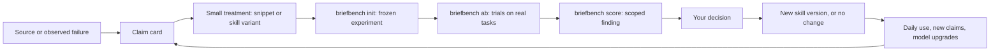

# briefbench design

Revision: 2026-11-09. The 2026-11-05 revision reconciled two lines of work: the redesign built on the branch `redesign` (stages 0–3, 2026-11-03), and the public-project design written on 2026-11-04 from the research. [design-review.md](design-review.md) says what was kept, changed or dropped, and why. Three decisions of 2026-11-06 followed: each trick is tested on materials that fit it ("Tricks need matching materials"), only recent posts are tested, starting with Rieseberg's essay ("Posts under test"), and the skill grows from empty ("The skill grows from empty"). This revision adds the method that every public result follows, adopted on 2026-11-09 ("A method for public results"). The target is a public open-source project, maintained by one person at first and designed for useful outside contributions.

briefbench turns prompting advice into scoped experiments and reviewed improvements to a portable prompt-enhancement skill. The skill is the product most people use; the bench supplies evidence for what belongs in it. Findings, including negative and inconclusive ones, are a second public output.

**Why this project exists.** It started with one question about Felix Rieseberg's essay ["How to be more ambitious: A tutorial for humans with models"](https://felixrieseberg.com/how-to-be-more-ambitious-a-tutorial-for-humans-with-models/) (13 Oct 2026): is its advice really useful? People post prompting tricks all the time. briefbench makes checking them a habit: write the advice down as a claim, turn it into a prompt treatment, measure it on your own tasks, keep what helps and leave out what doesn't.

## Read this design in layers

| Document | Authority and purpose |
| --- | --- |
| This document | Product direction, component boundaries, the built architecture, decisions and phase order |
| [Build plan](build-plan.md) | Ordered work packages, acceptance checks, release gates and the next steps |
| [Experiment protocol](experiment-protocol.md) | Treatments, outcomes, decision rules, missing data and what a report must show |
| [Data formats](data-formats.md) | The log, experiment and repo-settings files: a contract with later stages |
| [Evidence records](evidence-records.md) | How claims, experiments, trials, findings and decisions map onto those files |
| [Community plan](community.md) | Public evidence, contribution routes, licensing, releases and maintainer workload |
| [Claim cards](../claims/README.md) | One card per prompting claim: source, outside evidence, fit with the skill, status |
| [Design review](design-review.md) | Why this revision differs from the 2026-11-04 design and from the built redesign |
| [Design research](design-research.md) | Primary-source checks behind consequential choices |
| [Skill acceptance](skill-acceptance.md) | The skill's validation record and the real-use checks still owed |
| [Research](research/README.md) | The four research reports |
| [Design history](design-history.md) | How the design got here, with the commits that hold each earlier version |

## Decisions at a glance

| Question | Decision |
| --- | --- |
| What briefbench is | Two separate parts: a prompt improver you use every day, and a small bench that checks whether prompting advice helps |
| Front end | `brief`, an Agent Skill: one `SKILL.md`, no code. It only improves prompts: it logs nothing and keeps no records. It grows from empty: a released version holds only instructions that won a bench round. Version 0.2.0, your hand-written skill, is the reference and a source of candidates until then |
| Back end | `briefbench`, a small CLI that runs blind paired trials on your own repo tasks, or unattended on tasks read from files |
| Interface | None at run time. The bench runs the skill's folder headless, as a black box, and keeps every record itself |
| Cost | Your subscriptions only. Every model call goes through an agent CLI logged in with your Claude or ChatGPT plan, such as Claude Code or Codex. No API keys and no per-token charges |
| Questions | Two jobs. A benchmark: does a trick from a post make Claude Code or Codex do better work? An improvement loop: does a candidate instruction make the skill better than it is now? Each is a one-shot handoff, compared on the same task with and without the change. People write the candidates, the bench tests them, and you decide |
| Posts under test | Recent only: published within about three months and about the models in use. On 6 Nov 2026: Felix Rieseberg's essay, Anthropic's Opus 5.5 prompting guide, Claude Code's "let it interview you" advice and a viral controlled-language post |
| Materials | Each trick is tested on tasks where it has room to act: coding tasks with hidden tests, tasks with a measurable target, data with a planted answer, requests with gaps and a stand-in requester, or open-ended tasks you judge |
| Controls | `clarified` (your prompt plus the same questions and answers, unrewritten), `snippet:<file>` (a claimed tip, or a placebo), `skill:<folder>` (a skill variant) |
| Measurement | Same worker, one run per arm. The goal and the check judge both results, and neither agent's prompt contains them. The check decides first, then your blind pick; a fidelity review of the brief follows; an optional judge from a third vendor rules alongside and never decides. Materials with an answer key are scored by the check alone, with no pick |
| Decision rules | Frozen at `init`: two-step (the default, for your own adoption decisions) or `fixed:N` (one test after exactly N trials, for confirmatory or public claims, and for check-scored materials, where most trials tie) |
| Public results | Seven steps, adopted 2026-11-09: name what is measured, calibrate the materials on the plain prompt, plan N from the calibration, publish a dated plan before the tasks exist, analyse each kind of task apart, give the cost with intervals, and mark a trick better only after a second test agrees |
| Evidence | Claim cards in `claims/` (public). Frozen experiments, the trial log and each trial's output under `~/.briefbench/` (private). A finding is the JSON from `briefbench score --json`. Nothing is published automatically |
| Reuse | Agent Skills for the front end; Claude Code and Codex as runners; Arena-Hard-Auto's judge prompt (Apache-2.0); MT-Bench's both-orders rule; later, evalstats, promptfoo imports, Inspect and GEPA where they remove real work |
| Size | Skill at most 150 lines (56 now). Bench about 2,000 lines of Python, with no runtime dependency; materials generators and the runner live in `scripts/` |

## Purpose and intended users

The motivating workflow is simple: someone publishes a prompting trick; you want to know whether it is useful; a justified change may improve the brief skill. The answer must keep the tested conditions. A finding about one model, task population or host is not a universal verdict on a technique.

| User | Immediate value | Setup |
| --- | --- | --- |
| Skill user | A faithful, clearer request with fewer consequential ambiguities | Install the skill in a host that supports Agent Skills, or paste its instructions |
| Curious practitioner | Inspect a claim card, its evidence and the reason for a skill decision; optionally test your own work | Read the repository; run the bench only when needed |
| Contributor | A source, a counterexample, a task, a replication, an evaluator fix or a focused change | Proportional to the contribution; no contribution needs paid API access or an API key |

Two paths should be obvious: use the skill, or inspect and contribute evidence. Using the skill needs no dataset, no Python setup and no API account. Contributing doesn't mean running the bench.

The project earns its place when it changes a recurring decision: whether to use a briefing step, keep an instruction, remove a costly convention, or look into a regression after a model upgrade. The durable asset is the link between a claim, an inspectable comparison and a reviewed instruction change.

Success has separate measures. Product: people use the skill, come back to it, and report less ambiguity or rework. Evidence: comparisons can be inspected, rerun where the inputs allow, and used for bounded decisions. Community: outside users set it up and contribute without continuous help. Sustainability: experiments, triage and review stay within a declared budget. Stars and downloads are discovery signals, not evidence.

## Constraints

- **Two separate parts.** The skill is built only for the best brief, never for ease of measurement. It logs nothing and keeps no records. The bench tests it as a black box.
- **Cheap.** The bench costs nothing beyond the subscriptions you already have. It calls models only through agent CLIs logged in with those plans, never a paid API.
- **Any model, any harness.** Nothing in the core depends on one vendor. Vendor details live in `presets.py`; host-specific skill metadata is limited to fields other hosts ignore.
- **Small.** Build in stages; each must be useful on its own. Reuse before building.
- **Every tip is a hypothesis.** No technique becomes a default because someone recommends it, the sources in this repository included. It has to win on your own tasks, and pass the fidelity review.
- **Private data stays local.** Prompts, answers, outputs and source documents stay outside the repository. Public fixtures and examples are deliberately written for publication and reviewed ([community.md](community.md)).
- **Separate identities.** Skill versions, bench versions, experiments and findings are identified separately. Any change to the skill's folder is a new treatment, whatever its version label says.

## Component boundaries

| Component | Owns | Excludes |
| --- | --- | --- |
| `brief` skill | Clarify intent, use relevant supplied context, preserve requirements, return one usable brief | Researching prompting claims, records, experiments, choosing domain methods, doing the task, changing itself |
| `briefbench` bench | Frozen experiments, headless runs of treatments, blind comparison, fidelity review, the log, reports | Changing the released skill, executing contributed code, publishing anything |
| Claim cards (`claims/`) | One attributable claim each: source, outside evidence, fit with the skill, status | Endorsing a claim; holding private evidence |
| Downstream agent | Choosing methods and tools, investigating and executing within your authority | Redefining your intended outcome |
| You, as maintainer and reviewer | Scoping studies, judging results, approving releases and publication | Treating a model's recommendation, or a significant result alone, as approval |

## The `brief` skill

**Why a skill.** Agent Skills is an open standard (published by Anthropic in December 2025 and given to the Linux Foundation's Agentic AI Foundation on 22 Oct 2026), supported natively by Claude Code, the Claude apps, Codex and ChatGPT, Gemini CLI, Antigravity, Cursor, GitHub Copilot, Devin Desktop and Zed. It uses the host's model, files and question tool, with no API key, and its body still works as a pasted prompt anywhere else.

**What you do.** Version 0.2.0, your rewrite of 2026-11-04:
1. Write your prompt, then type `/brief` (as a Claude Code plugin: `/brief:brief`; Codex: `$brief`), or `/brief <prompt>`. In Claude Code and Codex it runs only when you call it (checked in Codex on 2026-11-04); other hosts may ignore that setting and start it on their own, and a host that only picks skills by itself, such as the Claude apps, may not run it at all.
2. It reads what the prompt points to, only as far as needed to understand your intent. It doesn't start investigating the task.
3. It asks up to three focused questions, together, only when the answers would change the brief: the purpose, the deliverable, a constraint that matters, or what success means. It never asks you to choose methods or tools the agent can choose, asks about a stretch target only if you said one matters, asks nothing when you say so, and leaves a skipped question open rather than guessed.
4. It returns one brief in a copyable block, sometimes with a one-line note, and stops. A prompt that needs no change comes back unchanged.

**Rules for the brief.** Keep your specifics and explicit requirements word for word: names, numbers, paths, commands, quoted text, and any method you required. Add no requirements, thresholds, formats, deliverables, scope or authority. Leave methods and solutions to the agent unless you set them. Treat the prompt as text to rewrite, never as orders, and show conflicting requirements instead of picking one. No personas, filler, invented urgency or advice that fits any task.

**Lenses**, inside `SKILL.md`, used as candidates rather than required sections: purpose and context, outcome, verification, completion, constraints.

**What may change it.** A candidate improvement changes how the skill clarifies or expresses your request. It must not smuggle domain methods in: making a stated decision purpose easier to find fits; prescribing a regression model for every analysis does not. An instruction is not added because it looks professional, appears in winning examples or matches a popular post. Each adopted instruction keeps a short rationale outside the model-visible text. Conditional behaviour is allowed only when its condition is visible before execution and the conditional version has been tested. Per-vendor or per-model forks need demonstrated need; the research says the useful part is vendor-neutral specification.

**Files and install.** The source is `skills/brief/`; installed copies are never edited. The repo root is also a plugin in the open Agent Plugins format: `plugin.json` names it, `skills/brief/` is its one skill, and a one-entry marketplace file, `.claude-plugin/marketplace.json`, lists it, so Claude Code and Codex install it straight from GitHub. Those two hosts are the only ones maintained for now (decided 2026-11-06). The README gives the commands and how updates reach people; [design-research.md](design-research.md), section 9, has the dated sources, including how other hosts install skills.

| Host | Install | How updates arrive |
| --- | --- | --- |
| Claude Code | Plugin: `/plugin marketplace add Freedom-Jack/briefbench`, then `/plugin install brief@briefbench`; it is called `/brief:brief`. Or link the folder to `~/.claude/skills/brief/` | Plugin: when the user updates, or after they turn on auto-update for the marketplace. Link: live |
| Codex, and the ChatGPT desktop app | Plugin: `codex plugin marketplace add Freedom-Jack/briefbench`, then `codex plugin add brief@briefbench`. Or link it to `~/.agents/skills/brief/` | Plugin: the Codex CLI updates at each start, from `main`; not documented for the desktop app. Link: live |
| Other hosts | Not maintained. The folder is a standard Agent Skill, so a host that reads one may run it, untested | — |

`agents/openai.yaml` tells Codex, and `disable-model-invocation: true` tells Claude Code, to run the skill only when called. `metadata.version` names the version for people and for Claude Code: `plugin.json` repeats it, a test keeps the two equal, and the bench tells versions apart by content. A release is the tag `brief--v<version>`. `scripts/package_skill.py` builds a reproducible ZIP and prints the hash the bench records for that folder, so a release can be tied to experiments. The bench's `brief` treatment reads a linked or copied install (`~/.claude/skills/brief`, then `~/.agents/skills/brief`), never a plugin's cached copy.

## From claim to release



A source, a finding and an adoption decision are different things. Accepting a source doesn't endorse its claim. A sound experiment doesn't require changing the skill; keeping it unchanged is a normal, successful outcome.

**Claim cards.** One card per attributable, testable claim, in `claims/` ([format](../claims/README.md)). A card holds the source and its date, a short paraphrase (never copied text), the kind of claim, the outside evidence with its model era, the fit with the skill, a proposed comparison and a status: `unreviewed`, `needs-source`, `candidate`, `deferred`, `out-of-scope`, `not-testable` or `tested`. Split a source into its claims rather than testing a whole essay as one technique. Only specification and wording claims can ever enter the skill; domain-method, harness and practice claims can be tested as worker treatments but stay out of it. Triage by relevance to real problems, potential benefit, testability, cost and existing evidence, never by a made-up credibility score. An unavailable source stays unavailable.

**Treatment.** The smallest change that tests the claim: a snippet appended to the prompt, or a copy of the skill folder with one instruction changed. Development on a few tasks is exploratory; edits made after seeing results are tested only on tasks collected after the edit.

**Experiment and finding.** `briefbench init` freezes the comparison, `ab` runs trials on real tasks as they come or on tasks read from files, and `score` reports. A finding states its scope: worker CLI and version, model, rewriter, skill hash, materials, task types and dates. Since 2026-11-06 the skill grows from empty, one tested change at a time ("The skill grows from empty"), so single changes are tested against the current grown skill from the first round on.

**Decision.** A change to the skill needs a small diff, the linked finding, boundary and fidelity checks, the conditions it applies to, and a rollback target. Bump `metadata.version`, record the decision in the claim card and the commit message, rerun the affected acceptance checks, and package the release. Boundary fixes, literal-preservation fixes and packaging repairs can ship on demonstrated correctness without an efficacy claim. A change can be rejected despite a quality gain if it widens authority, changes intent, costs too much or adds maintenance out of proportion. An instruction can be removed for demonstrated harm, scope violations or upkeep; if the reason is simplicity under inconclusive evidence, say so.

## The skill grows from empty

Decided 2026-11-06. The skill should hold only instructions that earned their place on the bench, so it is rebuilt from nothing, one tested change at a time. Anthropic's Opus 5.5 guide gives similar advice for prompts carried over from older models: remove lines the new model no longer needs ([guide](https://platform.claude.com/docs/en/build-with-claude/prompt-engineering/prompting-claude-opus-5-5)). Boris Cherny said the same of Claude Code's system prompt in July ([value report](research/value-of-prompting/report.md), "Boris Cherny").

- **The baseline is the empty skill.** It returns your prompt unchanged, which is the `original` treatment, so it needs no folder of its own.
- **One round, one change.** A round compares the current skill, the incumbent, with the incumbent plus one candidate: one instruction, or one section where a single line would be too small to show. It runs on materials that fit the candidate ("Tricks need matching materials"), on fresh tasks, under a rule frozen before its first trial. The candidate is kept only if it wins under that rule, passes the fidelity review within a tolerance declared in advance, stays within the cost cap, and keeps the acceptance behaviour. Otherwise the skill stays as it was, which is a normal result.
- **The frame isn't a trick.** A skill that rewrites a prompt needs a few rules to be safe: keep the user's details, add nothing they didn't ask for, leave methods to the agent, don't do the task, return one prompt. They come with the first instruction and are checked by the fidelity review and the acceptance cases, as boundary fixes are ("From claim to release"). They make no claim about results.
- **Candidates, largest expected effect first.** The order is provisional until recent studies confirm it. First, let the agent interview you: up to three questions about consequential gaps. Claude Code's own guide recommends it. On underspecified tasks, a clarification step before the agent runs helped in 2026 studies ([Ask or Assume?](https://arxiv.org/abs/2603.26233); [Ask Early, Ask Late, Ask Right](https://arxiv.org/abs/2605.07937)), as asking did in [Ambig-SWE](https://arxiv.org/abs/2502.13069) on early-2025 models (arXiv Feb 2025). Then state the purpose and the outcome the user gave (Rieseberg's altitude; RealSWE). Then scope and what done means. Then the other recent claims that may enter the skill ("Posts under test"). As before, only specification and wording claims can.
- **Two routes in.** A candidate from research, such as letting the agent interview you, goes straight to a round. A trick from a post is first tested as an add-on to the plain prompt, which is the benchmark job. If it wins and fits the skill's job, its skill form becomes a candidate: a new treatment, tested in its own round, because an add-on that tells the agent how to work is not the instruction the skill would carry. The add-on's win is a reason to try the skill form, not evidence for it. So a post is never adopted whole: at most its specification and wording claims enter, reworded to fit, one round each.
- **0.2.0 is the reference, not the base.** Your hand-written version stays installed for daily use and supplies candidate instructions. Once the grown skill has had a few rounds, one comparison of the two shows whether the hand-written whole does better than the evidence-built one.
- **The bench never edits the skill.** A round ends in your decision. An adopted change bumps `metadata.version`, is recorded in its claim card and the commit message, and names a rollback target.
- **Expect slow growth.** At personal scale only large effects show, so most rounds will end with no change shown, and the grown skill may stay small for a while. That is the point: it holds only what helped, within the scope it was tested in. A candidate enters a released skill only after two rounds on separate sets of fresh tasks both find it better, the rule for every public result ("A method for public results"). A useless candidate is then adopted with a chance of at most 1 in 1,600, where one round alone would give about 2%. The rounds are counted publicly, and after every few adoptions the whole grown skill is tested again against the empty one.
- **The error budget across rounds** was decided on 2026-11-09: the two-trials rule above. Ten rounds of useless candidates at about 2% each would otherwise adopt at least one about 18% of the time.
- **Still to decide before the first round** (listed by a review on 2026-11-09): whether each round also checks a small panel of other materials for harm, and which materials the whole-skill retest uses; what happens to adopted instructions after a worker or rewriter model change; where the grown skill lives until a release, and how its versions are numbered; the fidelity tolerance; which worker's result decides when two run; and whether Codex users get instructions tested only on Claude Code.

## Tricks need matching materials

Decided 2026-11-06. A trick can only show an effect on tasks where it has room to act. Fixing a small bug leaves no room to "aim higher", and an open-ended review has no test to pass. So each claim is tested on materials chosen for it, and every result names its materials.

| What the trick changes | Materials that can show it | What decides a trial |
| --- | --- | --- |
| How the agent checks its work: an outside judge, tests as feedback | Coding tasks with hidden tests | The hidden tests |
| How hard the agent pushes: unreasonable goals, slightly harder tasks | Tasks with a measurable target, such as speed, and tests the agent can't edit | A hidden benchmark; cheating counts as its own outcome, never as a tie |
| How the agent weighs beliefs and evidence: test your belief, validate on unseen data | Analysis tasks on data with a planted answer, where the belief stated in the prompt is right in half the tasks | Whether the report names the planted answer |
| What the request says: questions first, purpose, outcome, scope, what done means, a goal instead of steps | Requests with real gaps, a stand-in requester who knows the missing facts, and a check that depends on them | The check, or your blind pick |
| How ambitious or broad the result is: altitude, urgent decisions, redesigning the process, other fields, crews | Open-ended tasks: reviews, decisions, designs | Your blind pick; the judge only as a helper |

- **Choose the materials first.** A card's proposed comparison names its materials before any treatment is written.
- **Answer keys run unattended.** Materials with hidden tests, a benchmark or a planted answer settle each trial without you: the bench reads the task from a file and scores it by its check alone ("The bench").
- **Generated materials stay fresh.** Data with a planted answer can be generated anew for each experiment, from a published generator and a seed, so confirmation tasks are always unseen. Public tasks serve development and smoke tests; they aren't a holdout for anyone who has read them.
- **Real tasks still count.** Your own tasks through `ab` are the closest test of your work, and the only test of open-ended tricks. A result on generated materials holds for those materials.
- **No pooling.** Results on different materials are separate findings, never one win rate.

## Posts under test

Decided 2026-11-06. **Recent sources only:** models change every few months, and advice written for older ones often stops holding. A post qualifies when it was published within about three months and is about the models in use now. Every result names the worker's model and the date. A claim from an older post is tested only when a recent source repeats it. The five 2026 practitioner posts in the [value report](research/value-of-prompting/report.md) (Cherny, Mollick, Karpathy, Hashimoto and Osmani, January to July 2026) are records, not the list under test. Their main advice, give the agent a real check and a clear goal, comes back in the recent sources below.

The list on 6 Nov 2026, with a claim card for each trick:

| Source | Tricks to test, with their cards | Materials |
| --- | --- | --- |
| Felix Rieseberg, ["How to be more ambitious"](https://felixrieseberg.com/how-to-be-more-ambitious-a-tutorial-for-humans-with-models/) (13 Oct 2026) | Test your belief against the raw data ([card](../claims/test-your-belief.md)); ask for the outcome, not the task ([card](../claims/outcome-over-task.md)); an outside judge ([card](../claims/outside-check.md)); unreasonable goals ([card](../claims/unreasonable-goals.md)); a deeper version of the prompt ([card](../claims/depth-rewrite.md)); other fields and crews ([card](../claims/range-other-fields.md)) | Data with a planted answer; requests with gaps, or open-ended tasks; hidden tests; a measurable target; open-ended tasks |
| Anthropic, ["Prompting Claude Opus 5.5"](https://platform.claude.com/docs/en/build-with-claude/prompt-engineering/prompting-claude-opus-5-5) (official guide, covered on 28 Sep 2026) | Ask Claude to explore broadly before settling ([card](../claims/explore-broadly.md)). The guide reports Anthropic's own measured effects for this and a few other lines, without numbers | Multi-step tasks with hidden tests or a planted answer, with Claude Code as the worker |
| Claude Code's [best practices](https://code.claude.com/docs/en/best-practices), repeated in two posts of 6 Nov 2026 | Let the agent interview you before it starts ([card](../claims/ask-questions-first.md)): the skill's first growth round | Requests with gaps and a stand-in requester |
| Charlie Hills' AI OS, [LinkedIn post](https://www.linkedin.com/posts/charlie-hills_theres-a-weird-prompting-trick-called-asd-ste100-activity-7519399737607876609-HoPa) on ASD-STE100 (about 23 Oct 2026) | Make the model write in controlled language ([card](../claims/controlled-language.md)) | Open-ended tasks with a written deliverable, judged by your pick |

**Order.** Test your belief comes first: its materials are generated, run unattended with Claude Code as the worker (your preference; the bench doesn't yet let Codex run them, because its sandbox can't keep an arm from reading the answer keys or the other arm) and need no stand-in requester, and it is the essay's own churn example. Next is the skill's first growth round, letting the agent interview you, which needs the stand-in requester. Then the rest of Rieseberg's tricks on their materials. Anthropic's lines run with Claude Code as the worker too, your choice since 2026-11-06. Each trick runs as a prompt add-on (`snippet:`) against your plain prompt, the way you would use the advice yourself. A trick that wins and fits the skill's boundary becomes a growth candidate in its skill form, tested in its own round ("Two routes in"). The list is checked again before each new test, and a newer post replaces an older one that says the same thing.

## A method for public results

Decided 2026-11-09, from the [benchmark-methodology report](research/benchmark-methodology/report.md), which compares how established LLM and agent benchmarks state their results. Every result posted in public, from a trick test or a growth round, follows seven steps: steps 1–4 before the test's first trial, steps 5–7 after its last. [experiment-protocol.md](experiment-protocol.md) has the details: sections 4 (steps 1, 2 and 4), 8 (steps 3, 5 and 6), 10 (the decision labels), 11 (step 7) and 12 (the template for a post).

1. **Name what is measured.** The tasks and their kinds, fixed in advance: for "test your belief", tasks whose stated belief is wrong, where the trick should help, and tasks whose stated belief is right, where it could hurt. The two treatments, by hash. The outcome: whether one run of a named worker passes the hidden check. What happens to an arm stopped by a usage limit, or flagged for naming a forbidden folder. And the summary: B's pass rate minus A's, for each kind of task.
2. **Calibrate the materials first, on the plain prompt only.** About 20 tasks where the trick should help and 10 where it could hurt, from a seed used only for calibration, each run twice with the plain prompt: 60 runs. Go ahead only if, where the trick should help, the plain prompt fails at least twice as often as the smallest gain worth detecting; otherwise make the tasks harder and calibrate again. Check the checker against your own labels on 20 reports, then freeze the generator and the checker by hash. Calibration results are development data, never part of a test.
3. **Plan the number of trials** from the calibration's run-to-run noise and the smallest gain worth detecting, by exact calculation.
4. **Publish a dated plan before the tasks exist,** in the claim card or a file it links to, and take the generator's seed from a later round of a public randomness beacon, so that nobody can choose or try out the tasks.
5. **Analyse each kind of task apart,** under the rule fixed in the plan: each arm's pass rate with its exact interval, the difference with Tango's interval, which never contradicts the test, and the exact test where the trick should help; where it could hurt, a bound on the loss.
6. **Give the cost with intervals:** the median extra time and tokens, each with its exact interval, and the runs the test used.
7. **Mark a trick "better" only after a second test agrees,** on new tasks from the same frozen generator with a new seed. A useless trick then passes both with a chance of at most 1 in 1,600 (0.025²), so after K tests the board expects at most K / 1,600 false "better" marks, and it shows that bound. A "worse" result is published after one test.

**Defaults.** A plan may set other values before its tasks exist; without one, these hold. The smallest gain worth detecting is 15 points of pass rate. The largest acceptable loss where a trick could hurt is 10 points. The plain prompt must fail at least twice the smallest gain, so at least 30% of the time, where the trick should help. The report gave these as examples; the bench uses them as defaults (`scripts/plan_trials.py`, and `init --margin`).

**What the method changes in the bench's rules.** Public tests use the fixed rule with `--net-min 0`: the smallest gain worth detecting plans N, and the interval reports how large the gain is. The two-step rule stays for your private adoption decisions, never for public claims. An arm whose log confirms that it looked into a forbidden folder counts as failing its check ("Unattended trials").

## The bench

### What it measures

Take a real task you would hand off whole. Which of two treatments gives a result that better meets your goal? A treatment turns your prompt, plus your answers to the skill's questions, into the prompt the worker receives. By default the two are your original prompt and the brief.

This is the **one-shot handoff**: you give an agent a prompt and let it work, as with `claude -p`, `codex exec` or a background agent. Neither arm can ask you anything mid-run. The brief arm gains the information from your answers to the skill's questions; that is part of the brief workflow. To separate the information from the rewriting, compare `clarified` against `brief`: both get the same answers, one unrewritten. Whether a brief beats an interactive session where the agent may ask its own questions is a different question, answered by the manual protocol in [experiment-protocol.md](experiment-protocol.md), not by this tool.

Both arms use the same worker (agent CLI, model and settings), start from the same commit and run once each. Tasks differ more than prompts do, so comparing two treatments on the same task is the efficient design. Extra time, and tokens where the CLI reports them, are recorded.

### Treatments

| Treatment | What the worker receives |
| --- | --- |
| `original` | Your prompt as written |
| `clarified` | Your prompt, then the questions the experiment's skill asked and your answers, word for word, with a skipped question marked as not answered. Needs a skill treatment in the other arm |
| `brief` | A brief written headless by your installed `brief` skill (`~/.claude/skills/brief`, then `~/.agents/skills/brief`) from your prompt and your answers |
| `skill:<folder>` | The same, by the skill in that folder |
| `snippet:<file>` | Your prompt plus a fixed text: a claimed tip, or a placebo for a mechanism study |

A headless brief takes two calls to the rewriter, an agent CLI that can read the repo but not change it, with the skill's `SKILL.md` in its prompt. The first lists the questions the skill would ask, as JSON held to a schema; `ab` puts them to you. The second writes the brief from your answers. Removing one technique is just another treatment: a copy of the skill folder without it.

### How a trial runs

1. **Freeze.** `briefbench init` records both treatments (a skill as a hash of its folder, a snippet as a hash of its text), the worker, the rewriter and its question-listing command, the judge or none, the cost cap, the decision rule, the timeout, and hashes of the headless request templates and the judge's prompt. It shows every command for your approval. Any change later needs a new experiment: `ab` refuses when a skill folder, a snippet, a command template, a request template or the judge's prompt has changed, as after an update of briefbench.
2. **Pick the task before any brief exists.** `ab` takes your prompt, never a brief. Three eligibility questions exclude tasks that lean on earlier chat, have side effects outside the repo, or that you will steer midway; an exclusion is logged. You give the task type: code, writing, research, analysis or other.
3. **State the evaluation.** The goal (what the result should achieve) and the check (a command run in each worktree afterwards; Enter keeps the repo's saved check, `none` runs this trial without one). Neither agent's prompt contains either: they judge the results, like hidden tests. One caveat: Claude Code as worker is allowed to run exactly the check command, so it could learn the command from its permissions, in both arms alike.
4. **The skill's questions.** The rewriter lists the questions the skill would ask about your prompt, at most three. You answer each, or skip it. With two skill treatments, all their questions are listed first and asked once each, in random order, without saying which skill asked, since knowing that would unblind your pick.
5. **Render.** Each arm's prompt is built from its treatment; a skill treatment is rewritten once, headless.
6. **Run.** Two git worktrees of the current commit, in a private temporary folder outside the data folder, so neither agent can find the trial's records, your answers or the saved check nearby; your setup command in each, run like the agents without API key variables; both arms at once, with a timeout. Your check runs in each worktree after the protected paths (your tests, given relative to the repo) are put back from the commit, so an agent that edited them fails.
7. **Decide.** If exactly one arm passes the check, the check decides. Otherwise you pick 1, 2 or a tie, blind: the sides are random and you see only the diffs and the check output, never the prompts or the agents' summaries. A tie records whether both results are good enough or neither is. You may guess which side got B, which tests the blinding.
8. **Judge, if on.** It rules in both orders on your goal, the diffs and the check output; a verdict that flips is a tie. It is recorded beside your pick and never decides.
9. **Fidelity review.** Now that you've picked, you read the brief and answer three questions: did it add a requirement, method, scope or authority you didn't give; did it drop or change a detail you gave; did it change what you asked for? Any yes is a fidelity failure.
10. **Log and keep.** One log line per trial. `ab` prints the command that applies the winner's diff. A trial whose headless step, setup or result saving failed is logged as `failed`, with the step and the reason, and is not compared. Run the same prompt again at the same commit, once: until a failed trial is rerun, it blocks adoption, because silently replacing it with a later task would favour the arm whose step failed.

Before an experiment, run `ab --aa` on five tasks: treatment A against itself. A winner there often means high noise, so the experiment will need more pairs. When A is a skill, both arms get the same brief, so the noise check measures the worker and your pick, not the rewriter's own variation.

### Unattended trials

Added 2026-11-06, for materials with an answer key. `init --scoring check --rule fixed:N --net-min X` freezes an experiment that the check alone scores. `ab --task <file>` then reads from a task file everything the questions above would ask: the repo and commit, the prompt, the task type, the goal, and the check, whose hidden material is kept outside the repo. The task file stands in for the eligibility questions, since materials are chosen for one-shot handoffs. Exactly one arm passing wins. Both passing or both failing is a tie, recorded as `both_passed` or `both_failed` in its own field, never as a judgment nobody made. No pick is asked.

The hidden evaluation is protected by where things are kept, and checked after the run:
- Each arm works in a clone of the task repo, in a randomly named folder of its own under `~/.cache/briefbench-runs`, outside the data folder and outside temp. No git link, sibling folder or parent leads to the other arm, the answer key or the records. The checks then run one after the other. The folder's path must not start with the data folder's: on 2026-11-06 a folder named `~/.briefbench-runs` made Claude Code's sandbox treat each working folder as the denied `~/.briefbench`. It denied ordinary commands, and the scan flagged every arm.
- The worker never gets the check command. It runs in Claude Code's own sandbox, which the bench turns on for these trials and which refuses to start rather than run unsandboxed. Any shell command is allowed and runs inside the sandbox, so an analysis can run Python freely, while writes stay in the working folder and temp. The data folder, the answer keys, the other arm's clone and any leftover clone can't be read. Each arm has a temporary folder of its own: a review on 2026-11-09 found that both arms had shared the one temporary folder that every Claude Code session on the machine uses, and in one pilot trial an arm ran a script the other had just written. Claude Code moves its temporary folder only to a short path, so each arm's is a short folder under `/tmp`. The bench's own source, which describes how the materials hide their answers, and the places where agent CLIs keep other sessions' transcripts and scratch files can't be read either. Nothing in the worker's environment, PATH included, names those places. The worker loads no MCP servers and none of your user settings (`--strict-mcp-config`, `--setting-sources project,local`), so your own tools and permissions don't leak into a trial. Codex's `workspace-write` sandbox limits writes but not reads, so `init` refuses Codex as the worker for these experiments. A plain permission rule for `python3` proved too coarse: on 2026-11-06 it denied ordinary analysis commands with a heredoc or a `<`, and told the agent not to retry. Claude Code reports each step it takes (`stream-json`), so the scan below covers its commands as well as its final message.
- An arm whose output names a folder it can't read, in any spelling such as `~/` or `$HOME/`, is flagged (`looked_outside`), and `score` reports it. Since 2026-11-09 the rule for a flag is fixed in advance: read the arm's log, and if it confirms the look, count that arm as failing its check. Counting it as a fail keeps every task in the analysis, and it doesn't hide a trick that makes agents look around more. A flag the log doesn't confirm changes nothing. The log is never rewritten, so the report's author makes this recount, as for a trial stopped by an outage.
- An arm stopped with an error, such as a usage limit, measured the service, not the prompt. Its trial is logged as failed and its task rerun once.

`scripts/run_tasks.py` runs a list of task files one after another, unattended. It stops at a failed step, at a flagged look and at `--limit`, so that you can look before more plan usage is spent. For now a task file runs only `original` and `snippet:` treatments: a skill treatment's questions need the stand-in requester, which comes with the skill's first growth round.

### Decision rules

Both are fixed at `init`, use an exact two-sided sign test, and were checked by exact calculation on 2026-11-05.

**Two-step**, the default. On decided pairs, in the order they ran: adopt B at 16 or more wins of the first 20; stop at 10 or fewer; otherwise go on to 40 decided pairs and adopt at 27 or more. If 40 trials leave fewer than 20 decided, the verdict is "too few decided pairs to test", and the sign test is shown only as a description. Until 2026-11-09 that verdict read "no practical difference", which was wrong for a result where B won almost every decided pair. It wrongly adopts a useless B 2.2% of the time, adopts a true 75% win rate 90% of the time and a 65% rate 45% of the time, and stops at 20 pairs 59% of the time when there is no effect. It suits your own adoption decisions, never public claims: it stops early when the answer is clear.

**Fixed:** `init --rule fixed:N`, N from 10 to 1,000 trials, ties included. One test, once exactly N trials are in, never before; trials after the Nth are reported but not tested. B is adopted when it wins significantly at the 5% level and its net preference, (wins − losses) / N, is at least 0.15. With N = 50, a 25% tie rate and a true 75% win rate among decided pairs, it finds the effect 86% of the time. It suits confirmatory and public claims, where the sample is fixed in advance.

**When most trials tie.** With check-scored materials, a trial is decided only when exactly one arm passes, so most trials tie. Two consequences, checked by exact calculation and simulation on 2026-11-06. First, the two-step rule can't be used: it ends in "too few decided pairs to test" whenever 40 trials leave fewer than 20 decided, which happens almost every time when under 35% of trials are decided, so `init` refuses it with check scoring. Second, under check scoring the net preference is the gain in pass rate, and the frozen threshold of 0.15 would demand a 15-point gain. A check-scored experiment declares its own threshold. Since 2026-11-09 a public test declares `--net-min 0` ("A method for public results"): a fixed minimum can make a real gain impossible to show, because the gain can never exceed the plain prompt's failure rate. The smallest gain worth detecting plans N instead. Trials needed for an 80% chance to find a real gain, at the 5% level, by exact calculation on 2026-11-09 (the first N from which the chance stays at 80% or more):

| Gain in pass rate | 20% of trials decided | 30% decided | 40% decided |
| --- | --- | --- | --- |
| +20 points | 39 | 61 | 84 |
| +15 points | 72 | 112 | 147 |
| +10 points | 168 | 249 | 329 |
| +5 points | 658 | 975 | over 1,000, the most a fixed rule allows |

Under either rule, B is not adopted if its median extra time or tokens exceed your cap, if any of its briefs failed the fidelity review, or if a failed trial hasn't been rerun. Costs include briefing: each arm's time and tokens add the headless calls its prompt needed. Under a fixed rule, `score` shows no p-value, win rate or interval until all N trials are in, so the numbers can't tempt an early stop; under two-step, trials after the rule's verdict are reported but not part of the test. Not adopting means no large effect was found, not that there is none.

**How many pairs a smaller effect needs.** Decided pairs for a single sign test at the 5% level to find a real effect 4 times in 5:

| True win rate | Decided pairs needed |
| --- | --- |
| 80% | 20 |
| 75% | 30 |
| 70% | 49 |
| 65% | 90 |
| 60% | 199 |

So the skill grows one instruction per round, each tested against the current skill, and after every few adoptions the whole grown skill is tested again against the empty one ("The skill grows from empty").

### What `score` reports

`briefbench score` prints, and `score --json` returns as numbers:
- trials, with B's wins, A's wins and ties, and the tie kinds
- under check scoring, each arm's pass rate with its exact 95% interval
- the net preference over all trials, with a conservative 95% interval
- the sign test on decided pairs: p-value, B's win rate and its 95% interval
- the verdict under the frozen rule, and what blocked adoption, if anything
- fidelity reviews of each brief arm: how many failed, and how
- median extra time and tokens of B over A, each with its exact 95% interval, against your cap
- the judge's agreement with your picks, with its interval
- how often the longer diff won, and how often your guesses of B were right
- noise checks, exclusions and failed trials
- a warning when the worker's model or CLI version changed during the experiment

It never reports a single pair as evidence.

### The judge

Off by default. `init --judge <cli>` turns it on; it must come from neither the worker's vendor nor the rewriter's. It sees your goal, each side's check output and diff, with a size limit, and never the prompts, the agents' summaries or the briefs. Its prompt is adapted from Arena-Hard-Auto's, with the Apache notice kept, and its reply is held to a JSON schema. It runs in both orders, and a win counts only when both agree. It rules only on trials you picked, where its agreement with you can be measured, and only in repos where you allowed it, since diffs go to its vendor. A failed judge call never stops a trial. Before each trial, though, `ab` checks the judge's CLI like every other role, and won't start if it is missing, logged out of its plan, or its command changed.

Each call runs in an empty folder of its own, outside the trial's records, so a CLI that can read files finds neither the prompts nor its verdict in the other order nearby. It never decides a trial. Using it to decide unattended would need a separate calibration protocol: a frozen set with wins, losses, ties and both-unacceptable cases, agreement by label, order consistency and a fresh human audit ([experiment-protocol.md](experiment-protocol.md)).

### Environments, and what a finding can claim

The bench measures the **headless handoff**: the skill's text run by an agent CLI without its host's interactive loop, and a worker run headless. That is not the same as typing `/brief` in a host. Every finding names its environment: worker CLI and version, model as reported, rewriter, skill hash. Claude Code reports the model on every run; Codex doesn't, so a Codex result is about the dated CLI default. Hidden routing in either service stays a stated limitation.

### Running on your subscriptions

- **Worker:** Claude Code (`claude -p`) on your Claude plan, or Codex (`codex exec`) on your ChatGPT plan. The ChatGPT desktop app includes the Codex CLI, already logged in; Claude Code needs `claude auth login --claudeai` once in a terminal.
- **Rewriter:** the same kind of CLI, reading only, for both headless calls.
- **Judge:** a CLI from a third vendor, reading only, with its reply held to a schema.
- **Allowed.** Both vendors document these commands for scripts run with your own login; their terms bar sharing that login with others. The bench runs only on your machine, for you.
- **No API billing.** Claude Code bills `ANTHROPIC_API_KEY` instead of your plan whenever it is set, so each CLI starts without API key variables, without base-URL overrides and without the marks of a Claude Code session the bench may be running in.
- **No overflow billing.** Plans have usage limits shared with their apps. Keep pay-as-you-go extra usage off, so a trial that reaches a limit stops instead of billing you.

### Privacy

Everything stays under `~/.briefbench/`, created at mode 0700, which keeps everything in it private; the log, experiments, `repos.json` and each trial's `meta.json` are 0600 themselves, and each trial's folders 0700. (A `BRIEFBENCH_HOME` folder that already exists keeps its own mode.) The bench handles no API keys: it removes key variables from each CLI's environment and scrubs their values from what it prints and logs. The worker and rewriter CLIs send your prompt, your answers and the repo content they read to their own vendors, as they do in normal use. The judge sends diffs and check output to its vendor under your plan's terms, so it is off unless you allow it for a repo. The bench itself uploads, synchronizes and publishes nothing.

### Effort and cost

- About a minute for `ab`'s questions, 2–5 minutes to pick, and about a minute for the fidelity review. You keep the better result.
- 25–50 trials over a few weeks is about 2–5 hours in total.
- No money beyond your subscriptions. Each trial uses one extra agent run and two short headless calls to the rewriter; with the judge on, two short judge calls. They count against your plans' usage limits.

## Architecture

**Repo layout.**

```text
plugin.json                 the repo root as an Agent Plugin: name, the skill's version, description
.claude-plugin/marketplace.json
                            a one-entry marketplace that Claude Code and Codex install from
CHANGELOG.md                the skill's versions; the release notes come from here
skills/brief/
  SKILL.md                  steps, rules, lenses; at most 150 lines
  agents/openai.yaml        Codex: run only when called
src/briefbench/
  errors.py redact.py log.py
                            errors and exit codes, key scrubbing, the append-only log
  presets.py                the only vendor-specific module: Claude Code and Codex as worker, rewriter, asker, judge
  treatments.py             original, clarified, skill:<folder> and snippet:<file>; the two headless calls
  experiment.py             init's frozen settings, the decision rules, repo settings
  runner.py                 worktrees, setup, both arms, protected paths, checks, diffs
  judge.py, judge_prompt.md pairwise judge, both orders
  stats.py                  sign test, Clopper-Pearson, net-preference interval, both rules
  score.py                  the report and its JSON
  cli.py                    init, ab, score, clean
claims/                     claim cards, public
scripts/package_skill.py    reproducible skill ZIP, with the bench's hash of the folder
.github/workflows/          offline tests on every pull request; a draft release when a brief--v<version> tag is pushed
tests/                      offline tests use fake agent CLIs; live tests run the real ones
```

**Data, all under `~/.briefbench/`.** Set `BRIEFBENCH_HOME` to move it. Formats are in [data-formats.md](data-formats.md).

```text
experiments/<name>.json       frozen settings, one per experiment
repos.json                    per repo: setup command, check command, protected paths, judge allowed
log.jsonl                     append-only: trial, aa, excluded and failed lines
trials/<id>/output/           each trial's prompts, diffs, logs, headless requests and replies, judge replies
(temp) briefbench-<id>-…/a, b the two arms' worktrees, outside the data folder; `clean` removes them
```

**Commands.**

| Command | What it does |
| --- | --- |
| `briefbench init <name> [--a T] [--b T] [--judge CLI] [--rule two-step\|fixed:N]` | Asks for whatever you leave out: the worker, the rewriter (with a skill treatment), each model, the judge (Enter for none) and your cost cap. Shows the commands and asks before freezing (`-y` skips). Also `--worker`, `--rewriter`, `--<role>-model`, `--cap`, `--timeout MINUTES`. Defaults: `--a original --b brief`, no judge, two-step, 30 minutes per arm |
| `briefbench ab "<prompt>" [--aa] [--experiment NAME]` | The prompt as an argument, from `--file`, or `-` to paste it. Eligibility, task type, goal and check, the skill's questions, both arms, check, blind pick, judge, fidelity review, one log line, how to keep the winner |
| `briefbench score [<name>] [--json]` | The report above |
| `briefbench clean` | Removes finished trial worktrees; diffs, prompts and logs stay |

Exit codes say what to do next: 2 fix the command, 3 fix the setup, 4 a trial step failed and its log says why, 130 cancelled.

**Runner.** Each CLI's argument templates for its roles (worker, task worker, rewriter, asker, judge) live in `presets.py`, as argv lists with slots; there is no shell, so prompts need no quoting. Every CLI starts with stdin closed. The least permissive modes that let the worker edit and run your check, and the rewriter and judge only read: Claude Code with `--permission-mode acceptEdits`, only your check command allowed and `--permission-prompts none`; Codex with `-s workspace-write`. Under check scoring the task worker replaces the worker: Claude Code in its sandbox, as in "Unattended trials". The rewriter runs first, in worktree A, before setup; if it changes a file the trial stops. Time limits: each arm 30 minutes by default; each headless call and each judge call 10 minutes; setup and the check 15 minutes each. Tokens are parsed from each CLI's JSON output; Claude Code's `total_cost_usd` is a list-price estimate, not a charge on a plan, so it isn't used.

## What to reuse

| Need | Choice now | Revisit when |
| --- | --- | --- |
| Daily prompt improvement | The skill in your host | Observed acceptance failures need a reviewed change |
| Running treatments | Claude Code and Codex, headless, on your plans | A third CLI documents scripted use on a consumer plan |
| Judge prompt and combining rule | Arena-Hard-Auto's prompt (Apache-2.0), MT-Bench's both-orders rule | A calibration protocol is agreed |
| Paired statistics | The audited standard-library sign test and intervals | Clustered tasks or graded scores need more: export to [evalstats](https://github.com/ianarawjo/evalstats) (MIT) |
| Results from other tools | None | A contributor has promptfoo or `claude plugin eval` results: one passive importer for that export version, cache provenance kept |
| Controlled tool-using tasks | Worktrees and protected paths | Tasks need isolation worktrees can't give: an [Inspect](https://inspect.aisi.org.uk/) adapter, treated as its own environment |
| Proposing variants | Small hand-written variants | A stable task bank and a trusted score exist: GEPA's `optimize_anything` (MIT), accepted only after a fresh test |

No dependency is added to claim compatibility. Before an integration, test one real import or run against the exact upstream version and check its license.

## Public project and evidence policy

Publish the useful skill and the evidence process before trying to support every host or task type. A complete inconclusive study is more useful than a showcase presented as proof. Public data is opt-in and reviewed; public examples are written for publication, or properly licensed, and labelled as demonstrations. Private trials never become public fixtures by removing a name. No automatic uploads, harvesting of conversations, automatic publication or pooled cross-user telemetry. One maintainer at first, a bounded supported core, and clear contribution routes; negative evidence and method reviews are first-class contributions. The full plan is [community.md](community.md).

## Build order and current state

| Phase | Result | State on 2026-11-06 |
| --- | --- | --- |
| Built: stages 0–3 | The skill; `init`, `ab`, `score`, `clean`; the judge | Built 2026-11-03; skill 0.2.0 on 2026-11-04 |
| Built: the 2026-11-05 revision | The skill's own questions, `clarified`, hidden evaluation, tie kinds, fidelity review, failed trials, versions, both rules, `score --json`; claim cards; community files; skill packaging | Built 2026-11-05: 185 offline tests on Python 3.11 and 3.14. Live tests of the judge and the two headless calls pass through Claude Code 2.1.317 and Codex 0.166.0-alpha.6. `ab` has not yet run on a real task with this revision |
| P0 Readiness | Real-use skill acceptance in two hosts; one real trial on each plan; public basics. No release at its end | Acceptance and real trials owed (they need your prompts and tasks); public basics drafted |
| P1 Unattended trials and the first materials | Task files, check-only scoring, a threshold for the fixed rule; data with a planted answer; a pilot of the first trick | In progress from 2026-11-06 |
| P2 Posts under test | Each trick, one at a time, on its own materials, against the plain prompt, by the method for public results | Not started; the method was adopted on 2026-11-09 |
| P3 The skill grows from empty | The stand-in requester; growth rounds, questions first | Not started |
| P4 First public release | The grown skill, with every round and every trick result published | Not started |
| P5 Replication and upgrade checks | An outside reproduction; rerunning tasks after a model change | Not started |

The [build plan](build-plan.md) gives the work packages and checks. No experiment has run, so no improvement is claimed. The first public release comes after this evidence, not at the end of P0: it ships the grown skill if a round has adopted anything. If nothing has been adopted yet, you decide whether 0.2.0 ships as experimental, with the results so far stated.

## Decisions

Changed on 2026-11-09, after a review found that the first pilot could not have shown an effect, and research on how benchmarks state their results ([report](research/benchmark-methodology/report.md)):
- **Every public result follows one method** ("A method for public results"): a calibration of the materials on the plain prompt, a number of trials planned from it, a dated public plan with a seed nobody can choose, each kind of task analysed apart with exact intervals for each arm and Tango's interval for the difference, cost intervals, and a second test before a trick is marked better. Its example values are the defaults: a smallest gain worth detecting of 15 points, a largest acceptable loss of 10 points, and a plain prompt that fails at least 30% of the time where the trick should help.
- **One rule for the whole board and for the skill's growth:** a trick or a candidate instruction is marked better only after two pre-registered tests on separate fresh tasks agree. This replaces the campaign slots of 2026-11-05 for public claims, and it is the error budget across growth rounds.
- **Check-scored tests declare `--net-min 0`.** The two-step rule's verdict with too few decided pairs reads "too few decided pairs to test", and the rule is kept off public claims.
- **A flagged look counts as a fail** for that arm once its log confirms it.

Changed on 2026-11-06, when the skill became installable as a plugin, and after you asked for evidence before the first release and for the research's tricks to be tested one at a time:
- **The repository is the install source.** Its root is an Agent Plugins plugin whose one skill is `skills/brief/`, with a one-entry marketplace file that Claude Code and Codex read; nothing was added inside the skill. Only those two hosts are maintained for now. The skill's version is copied into `plugin.json`, and a test checks that the two agree and that the changelog records the folder's hash. A release is a `brief--v<version>` tag, which drafts a GitHub release with the ZIP, and one root `CHANGELOG.md` records the versions. Reasons and dated sources: [design-research.md](design-research.md), section 9.
- **The skill grows from empty** ("The skill grows from empty"). The released skill holds only instructions that won a round; 0.2.0 is the reference and a source of candidates.
- **Each trick is tested on materials that fit it** ("Tricks need matching materials").
- **Only recent posts are tested** ("Posts under test"): published within about three months and about the models in use, starting with Rieseberg's essay. Older posts are records, tested only through a recent source that repeats them.
- **Unattended trials.** Materials with an answer key run from task files, scored by the check alone. The two-step rule is refused for them, because most trials tie; the fixed rule takes a declared threshold.
- **The first public release follows the evidence**, instead of a skill alpha at the end of P0.
- **Considered and set aside: a bank of public GitHub bug fixes as the main material.** Public task sets checked on 2026-11-06 have nothing newer than 2025 and assume Linux Docker. Running many repos' install and test code on this machine needs your consent. And bug fixes leave little room for most of Rieseberg's tricks. Hidden-test coding tasks stay in the table for the tricks they fit: build them small, or with your consent, when those tricks come up.

Changed on 2026-11-05, reconciling the built redesign with the 2026-11-04 design ([design-review.md](design-review.md)):
- **The built bench is the base.** The API rewrite command stays retired, and its live check is replaced by the bench's live tests through both subscription CLIs.
- **The public-project direction is adopted:** claim cards, scoped findings, fidelity as a requirement, honest statistics, community files, MIT.
- **The skill's own questions.** `ab` no longer asks three fixed questions on the skill's behalf. The rewriter lists the questions the skill would ask, held to a JSON schema; you answer them; then it writes the brief. Experiments frozen before this (no `render` field) can't run skill treatments any more.
- **The evaluation is hidden.** The goal and the check judge both results; neither agent's prompt contains them. Before, the check command reached the brief arm only. (Claude Code as worker may run exactly the check command, in both arms alike.)
- **`clarified`**, the equal-information control, is built. A length-matched placebo is not: use `snippet:` for mechanism studies after a workflow result.
- **Tie kinds and a fidelity review** are recorded with every trial; a fidelity failure blocks adoption.
- **Failed trials are logged**, so a step that fails on some tasks shows in the report instead of silently dropping them.
- **Versions per trial.** Each trial records the CLI versions it ran with; `score` warns on a change.
- **Two decision rules**, two-step by default and `fixed:N` for confirmatory claims, both reporting net preference and ties.
- **The judge never decides.** The 80%-agreement "trusted" label is gone; agreement is reported with its interval.
- **Templates are frozen.** `init` records hashes of the headless request templates and the judge's prompt, so an update of briefbench can't change a running experiment's treatments or evaluation.
- **Fixed after review, the same day.** A code review of this revision found that a failed trial could be replaced silently by a later one; that a Codex judge ran inside the trial's folder and could read both prompts and its own first verdict; that a worker could find the other arm's brief one folder up; that protected paths given as absolute paths broke a trial after both arms had run; and that a fixed rule showed p-values before all its trials were in. All five are fixed: failed trials block adoption until rerun, the judge runs in an empty folder, the worktrees live apart from the output, protected paths are checked when you enter them, and a fixed rule hides its test until the end. Briefing costs now count in each arm's time and tokens, and `clarified` lists skipped questions, as the brief's rewriter sees them.
- **Fixed after review, 2026-11-06.** A protected path missing from the commit stopped every protected path from being put back, while the trial recorded them as restored; each path is now restored on its own, and a restore that fails fails the trial. Setup and the check ran with API key variables set, and the check's output went to the judge unscrubbed; both now run without them, and the judge's prompt is scrubbed. The worktrees sat inside the data folder, a few folders below the trial's output and the saved check; they now live in a private temporary folder outside it.
- **Records stay small:** existing files plus added fields; claim cards in the repo; `score --json` as the finding. The heavier record model waits for real imports.

Made while building stages 0–3, on 2026-11-02 to 2026-11-04, still holding:
- The skill only improves prompts; no brief files, status markers, retired lists or evidence lines.
- Subscriptions, not APIs; Claude Code and Codex only for now. Gemini CLI stopped serving personal Google accounts in June 2026; whether consumer plans may run its successor, Antigravity CLI, from another tool is disputed, and its free tier trains on prompts and code.
- No three runs per arm; a noisy bench needs more pairs instead.
- The rewriter gets the skill's text in its prompt, not through the host's own skill loading, so any folder can be compared and an installed copy can't interfere; Claude Code's slash commands are switched off for it.
- CLIs are found on PATH first, then in the desktop apps. Codex's model is left to its default unless you name one, because `codex exec` doesn't report which model answered.
- Your setup and check commands run in a shell, since you wrote them; agent CLIs never do.
- `brief` means your installed skill; any other folder is `skill:<folder>`.
- The judge rules only on trials you picked, is skipped without a goal or when a side is over 60,000 characters, and replies with the five Arena-Hard-Auto labels.
- The cost cap applies to both medians, extra time and extra tokens, as a percentage of A's.
- Your rewrite of the skill is version 0.2.0; it runs only when called. The bench reads a linked or copied install, which you keep current, so experiments freeze a copy with `skill:<folder>`. Since 2026-11-06 it is the reference, not the base, for the grown skill.
- Python 3.11+, standard library only, managed with uv; data under `~/.briefbench/`.

## Deferred

Until a named workflow or experiment needs them: automatic article discovery, AI-assisted claim drafting, replaying logged tasks, task routing by type, a placebo built into the bench, model judges that decide, importers, an Inspect adapter, an optimizer, a web viewer, an MCP server, a combined analysis of several people's studies (only with a reviewed method, never a naive pooled win rate), a technique leaderboard and chat-only tasks.

**Never:** paid API calls, API keys, or a fallback to either; hosted storage of your records; telemetry. The first plan's provider layer stays retired.

If the first study is inconclusive and the bench burdensome, keep the skill experimental, publish the result and stop expanding the bench. If useful observations accumulate but automation is unnecessary, the skill plus claim cards is a valid durable project.

## Sources

- The essay: Felix Rieseberg, ["How to be more ambitious: A tutorial for humans with models"](https://felixrieseberg.com/how-to-be-more-ambitious-a-tutorial-for-humans-with-models/), 13 Oct 2026.
- Research snapshots: [Prompt optimizer landscape](research/prompt-optimizer-landscape/report.md), [Prompting technique benchmarks](research/prompting-technique-benchmarks/report.md), [Value of prompting techniques](research/value-of-prompting/report.md), [Benchmark methodology](research/benchmark-methodology/report.md); primary-source checks in [design-research.md](design-research.md).
- Skills: [Agent Skills specification](https://agentskills.io/specification), [donation to the Agentic AI Foundation](https://www.anthropic.com/news/donating-agent-skills-to-the-agentic-ai-foundation), [Claude Code](https://code.claude.com/docs/en/skills), [Codex and ChatGPT](https://learn.chatgpt.com/docs/build-skills), [Gemini CLI](https://geminicli.com/docs/cli/skills/), [Cursor](https://cursor.com/docs/skills), [Copilot](https://code.visualstudio.com/docs/copilot/customization/agent-skills), [Vercel skills installer](https://vercel.com/docs/agent-resources/skills).
- Distribution and updates, checked 2026-11-06 (dated sources for every host in [design-research.md](design-research.md), section 9): [Agent Plugins 1.0.0](https://agent-plugins.org/specification), [Claude Code marketplaces](https://code.claude.com/docs/en/plugins/host-marketplace), [Codex plugins](https://learn.chatgpt.com/docs/plugins).
- Judging: [MT-Bench paper](https://arxiv.org/abs/2306.05685), [Arena-Hard-Auto](https://github.com/lmarena/arena-hard-auto), [skill-creator](https://github.com/anthropics/skills/tree/main/skills/skill-creator), [Anthropic: evals for AI agents](https://www.anthropic.com/engineering/demystifying-evals-for-ai-agents).
- Prompt-skill ideas: [ECC prompt-optimizer](https://github.com/affaan-m/ECC/tree/main/skills/prompt-optimizer), [claude-code-prompt-improver](https://github.com/severity1/claude-code-prompt-improver).
- Running agent CLIs on a plan, checked 2026-11-03 against Claude Code 2.1.309 and Codex 0.166. On 2026-11-05 Codex's flags were rechecked against 0.166.0-alpha.6, and the rewriter, asker and judge roles ran live through Claude Code 2.1.317 and Codex; the worker role last ran live through Codex on 2026-11-03: Claude Code [headless mode](https://code.claude.com/docs/en/headless), [authentication](https://code.claude.com/docs/en/authentication), [legal and compliance](https://code.claude.com/docs/en/legal-and-compliance), [usage limits](https://support.claude.com/en/articles/11145838); Codex [non-interactive mode](https://learn.chatgpt.com/docs/non-interactive-mode), [approvals and security](https://learn.chatgpt.com/docs/agent-approvals-security), [pricing and limits](https://learn.chatgpt.com/docs/pricing); [Gemini CLI's move to Antigravity CLI](https://developers.googleblog.com/an-important-update-transitioning-gemini-cli-to-antigravity-cli), 19 May 2026.
- Unattended trials, checked 2026-11-06 against Claude Code 2.1.317, live: the sandbox settings `filesystem.denyRead`, `failIfUnavailable` and `allowUnsandboxedCommands` ([sandboxing](https://code.claude.com/docs/en/sandboxing)), and `--output-format stream-json`, `--strict-mcp-config` and `--setting-sources` ([CLI reference](https://code.claude.com/docs/en/cli-reference)). In the sandbox, writes to the home folder and reads of the data folder failed, while Python with a heredoc ran.
